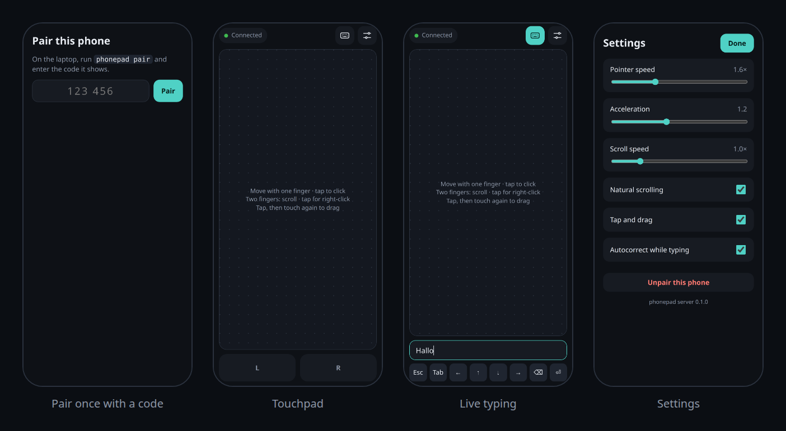

# phonepad

Use your iPhone as touchpad and keyboard for your Linux laptop, for example from the sofa while
the laptop drives the TV. The laptop serves a small web app; the phone opens it in Safari or as
a home-screen app. Nothing is installed on the phone, and the laptop accepts phones only on
networks you trust.



- One finger moves the pointer, a tap clicks, tap-then-touch drags; **L** / **R** buttons too.
- Two fingers scroll smoothly (pixel-precise, through a virtual mouse); a two-finger tap is a
  right click.
- Live typing with the phone's keyboard, including autocorrect, dictation, accents and emoji,
  on any laptop keyboard layout. Special keys: Esc, Tab, arrows, Backspace, Enter.
- Pairing with a QR code or a one-time code; per-phone tokens you can revoke.

Requirements and behaviour: [docs/SPEC.md](docs/SPEC.md). Why it is built this way:
[docs/decisions/](docs/decisions/README.md).

## Requirements

- Linux with an **X11** session (the keyboard uses XTest; Wayland is not supported yet),
  NetworkManager, and a systemd user session for autostart. Developed and tested on Linux Mint
  22 with Cinnamon.
- Python 3.11 or newer. `evdev` is compiled during installation, so you need a C compiler and
  the Python headers (Debian/Ubuntu: `sudo apt install build-essential python3-dev python3-venv`),
  or use conda, which brings the headers.
- A phone on the same network. Tested with an iPhone (Safari and home-screen app); other
  modern mobile browsers should work but are untested.

## Setup

### 1. Install

```bash
git clone https://github.com/<you>/phonepad.git
cd phonepad
python3 -m venv .venv && .venv/bin/pip install .
ln -s "$PWD/.venv/bin/phonepad" ~/.local/bin/phonepad     # puts `phonepad` on your PATH
```

With conda instead: `conda create -n phonepad python=3.12 && conda activate phonepad && pip install .`

### 2. System setup (once, needs sudo)

Either run the script (read it first; it prints what it does):

```bash
sudo scripts/setup-system.sh          # undo: sudo scripts/setup-system.sh --remove
```

or do the same by hand:

1. Give the logged-in user access to `/dev/uinput` (for the virtual mouse). Create
   `/etc/udev/rules.d/70-phonepad-uinput.rules`, owner `root:root`, mode `0644`, with this line:

   ```
   KERNEL=="uinput", SUBSYSTEM=="misc", TAG+="uaccess", OPTIONS+="static_node=uinput"
   ```

   Then run
   `sudo udevadm control --reload-rules && sudo udevadm trigger --sysname-match=uinput --action=change`.
   Check with `test -w /dev/uinput && echo ok` (or log out and in).
2. If you use ufw, open the port for your home subnet only. Find the subnet with
   `ip -4 route show proto kernel scope link` (for example `192.168.1.0/24`), then:

   ```bash
   sudo ufw allow from 192.168.1.0/24 to any port 8790 proto tcp comment 'phonepad'
   ```

Without step 1 phonepad still works, with an XTest pointer (scrolling then moves in notches).

### 3. Trust your home network, start, pair

```bash
phonepad trust              # while connected to your home network
phonepad service install    # start now and at every login (systemd user unit + autostart)
phonepad pair               # shows a QR code and a 6-digit code
phonepad doctor             # checks everything above
```

On the phone, scan the QR code with the camera: it opens the web app in the browser and pairs
it. For the full-screen app on an iPhone: Safari → Share → **Add to Home Screen**, open it from
the home screen and type a code there (home-screen apps have their own storage, so they pair
separately; run `phonepad pair` again for a fresh code).

Tip: reserve the laptop's IP address in your router (DHCP reservation); the home-screen app
remembers the address.

## Daily use

The phone stays paired. It is connected while the app is open and reconnects by itself
within about a second when you open it again (iOS closes the connection when the phone locks
or the app goes to the background). It cannot connect while the laptop sleeps or is on a
network you have not trusted. The phone's screen may auto-lock while you use the touchpad;
raise Auto-Lock in the phone's settings if that bothers you.

## Commands

| Command                                     | What it does                                             |
| ------------------------------------------- | -------------------------------------------------------- |
| `phonepad pair`                             | new pairing code + QR code (5 minutes, one phone)        |
| `phonepad devices`                          | paired phones                                            |
| `phonepad revoke ID` / `--all`              | unpair (the phone is disconnected within seconds)        |
| `phonepad trust` / `untrust NAME`           | trust or stop trusting a network                         |
| `phonepad networks`                         | trusted and active networks                              |
| `phonepad service install/uninstall/status` | autostart at login                                       |
| `phonepad serve`                            | run in the foreground (`--help` for development options) |
| `phonepad doctor`                           | check the setup, with hints                              |

Logs: `journalctl --user -u phonepad -f`. Settings (optional):
`~/.config/phonepad/config.toml` with `port` (default 8790), `pointer_backend`
(`auto`/`uinput`/`xtest`) and `advertise_host` (host name for the pairing URL).

## What the setup changes

| Change                                      | Path / place                                              | Made by                    |
| ------------------------------------------- | --------------------------------------------------------- | -------------------------- |
| Python environment                          | `.venv/` in the clone (or the conda env)                  | step 1                     |
| `phonepad` command                          | `~/.local/bin/phonepad` (symlink)                         | step 1                     |
| udev rule (uinput access)                   | `/etc/udev/rules.d/70-phonepad-uinput.rules` (root, 0644) | step 2 (sudo)              |
| firewall rule                               | ufw rule with comment `phonepad`                          | step 2 (sudo)              |
| systemd user unit                           | `~/.config/systemd/user/phonepad.service`                 | `phonepad service install` |
| autostart entry                             | `~/.config/autostart/phonepad.desktop`                    | `phonepad service install` |
| state (devices, networks, claimed keycodes) | `~/.local/state/phonepad/` (0700, files 0600)             | `trust`, `pair`, server    |
| settings (optional)                         | `~/.config/phonepad/config.toml`                          | you, by hand               |
| on the phone                                | home-screen icon, browser site data for the laptop        | you                        |

Nothing else is written. The server changes the X keymap only while it runs (spare keycodes,
cleared on exit, and reclaimed on the next start after a crash) and creates the virtual mouse
only while it runs.

## Uninstall

In this order (the service first, so nothing recreates state while you delete it), from the
clone:

```bash
phonepad service uninstall                         # stops the server, removes unit + autostart entry
sudo scripts/setup-system.sh --remove              # udev rule + ufw rule
rm -rf ~/.local/state/phonepad ~/.config/phonepad  # paired devices, trusted networks, settings
rm ~/.local/bin/phonepad                           # the symlink (conda: conda env remove -n phonepad)
cd .. && rm -rf phonepad                           # the clone, including .venv
```

By hand instead of the commands:

1. Service: `systemctl --user stop phonepad.service`, then delete
   `~/.config/systemd/user/phonepad.service` and `~/.config/autostart/phonepad.desktop`, then
   `systemctl --user daemon-reload`.
2. udev: `sudo rm /etc/udev/rules.d/70-phonepad-uinput.rules && sudo udevadm control --reload-rules`.
   The access to `/dev/uinput` granted earlier ends at the next reboot.
3. Firewall: `sudo ufw status numbered`, then `sudo ufw delete <number>` for each line with the
   comment `phonepad`.
4. State, settings, symlink and clone: as in the commands above.
5. iPhone: long-press the phonepad icon → Delete Bookmark; Settings → Apps → Safari → Advanced
   → Website Data → remove the laptop's address.

`phonepad doctor` before step 4 shows what is still in place.

## Security

- Only phones that paired with a one-time code (6 digits, 5 minutes, 5 tries) can connect;
  each has its own revocable 256-bit token, stored on the laptop as a hash.
- The server listens on the LAN only while connected to a trusted network, and only on that
  network's address; the firewall rule limits the port to the home subnet. Requests for
  unknown host names and cross-site WebSockets are refused.
- Plain HTTP on the home network: someone sniffing your Wi-Fi could copy a token. See
  [ADR-0004](docs/decisions/0004-pairing-code-and-device-tokens.md).

Found a security problem? Please open a GitHub issue without details and ask for a private
contact, or use GitHub's private vulnerability reporting if it is enabled.

## Known limitations

- X11 only for the keyboard ([ADR-0003](docs/decisions/0003-uinput-pointer-and-xtest-keyboard.md)).
- Backspace is sent per user-visible character. Terminals delete per code point, so editing
  right after an emoji sequence (👍🏽) or a decomposed accent can leave a remainder there.
- Safari (not the home-screen app) may delete the page's data after 7 days without use; the
  phone then has to pair again.
- Open questions that need more testing on a real phone are listed in
  [docs/STATE.md](docs/STATE.md).

## Development

Agents (and humans) working on the code: start with [AGENTS.md](AGENTS.md).

```bash
python3 -m venv .venv && . .venv/bin/activate   # or a conda env
pip install -U pip && pip install -e . --group dev   # pytest, ruff, mypy, pre-commit (pip >= 25.1)
npm install                      # Biome (JS/CSS lint + format), puppeteer-core (e2e)
pre-commit install

make check    # format check, lint, types, Python + JS unit tests, e2e (headless Chrome)
make xtest    # real XTest typing against a throwaway X server (Xvfb or Xephyr)
make fmt      # apply formatting
make icons    # redraw the app icons
```

Tests never inject input into your real desktop: the e2e test records input to a file, and
`make xtest` uses a separate X server. CI runs all of this on every push
([.github/workflows/ci.yml](.github/workflows/ci.yml)).

Versioning follows [SemVer](https://semver.org); changes are listed in
[CHANGELOG.md](CHANGELOG.md), releases are git tags `vX.Y.Z`. The version lives only in
`src/phonepad/__init__.py`. Commit messages follow
[Conventional Commits](https://www.conventionalcommits.org).

## License

[MIT](LICENSE)
